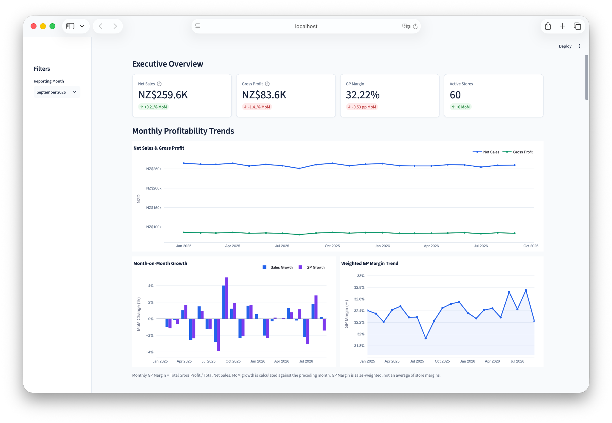
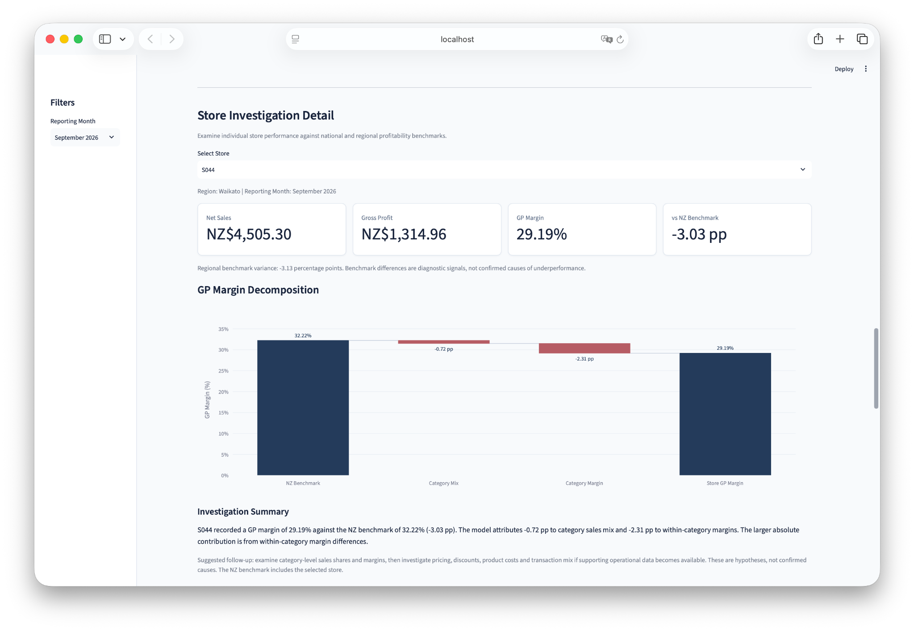
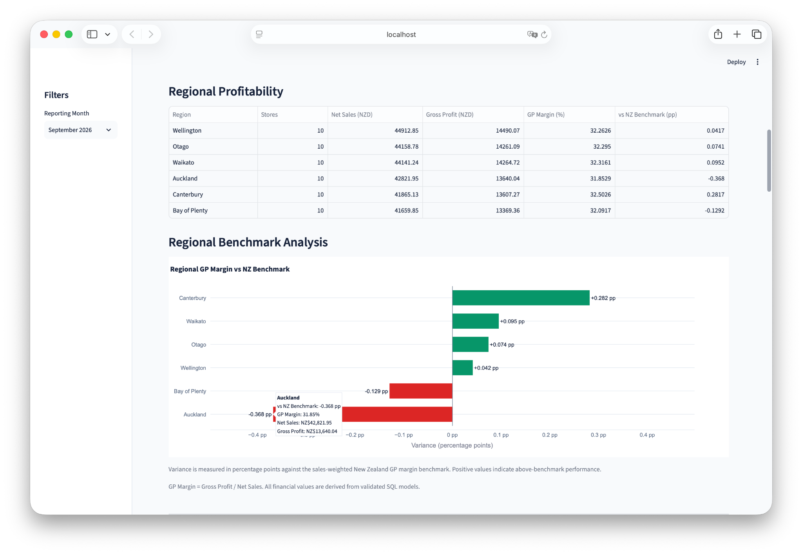
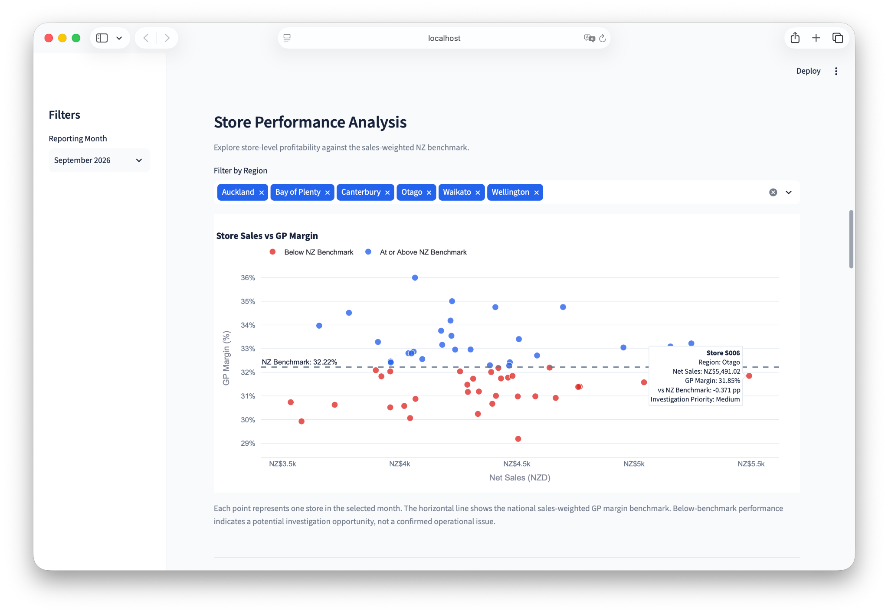
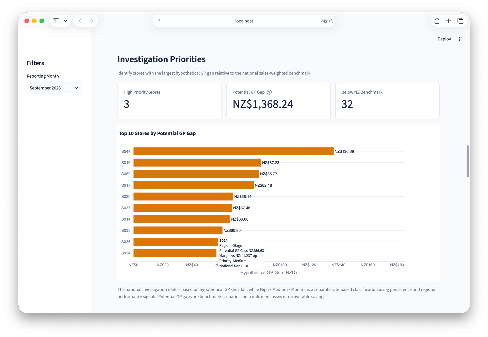
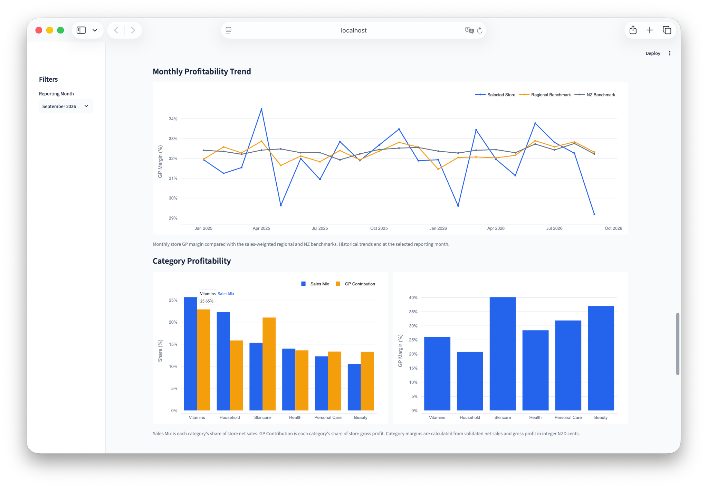
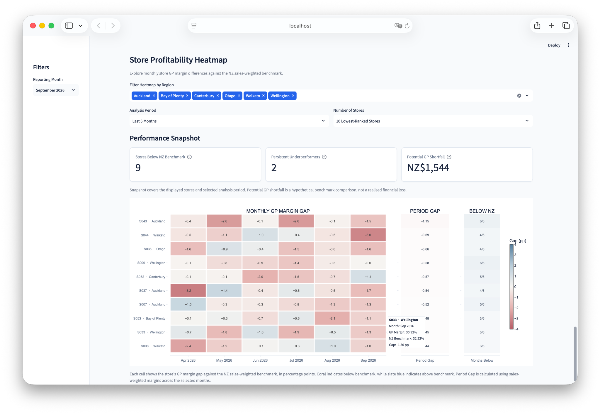
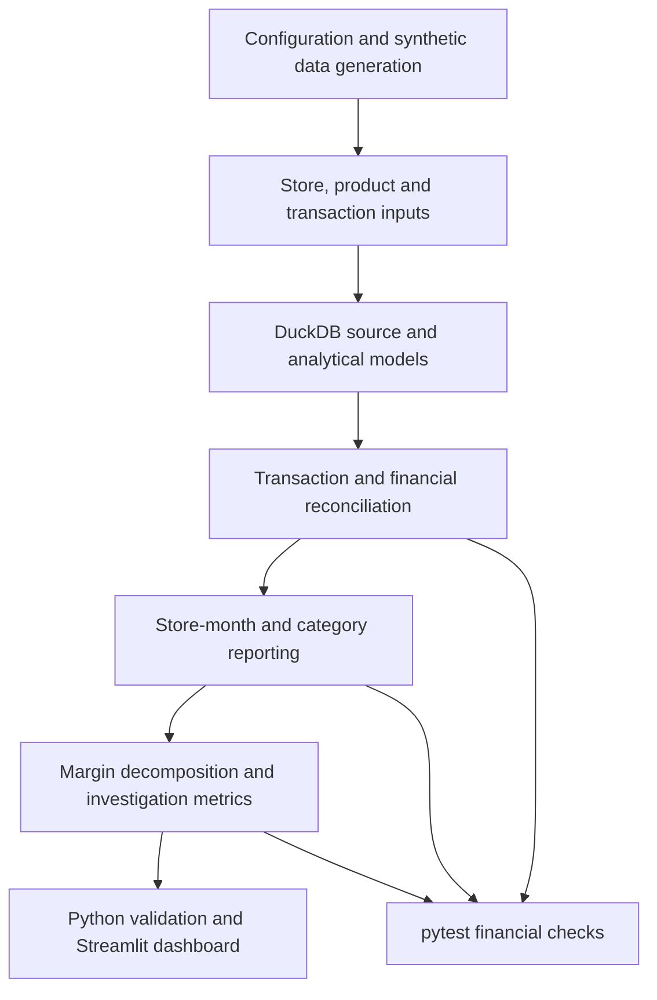

# MarginIQ — Commercial Performance Analytics

**From reconciled retail transactions to actionable profitability investigations.**

MarginIQ is an end-to-end retail analytics project built with Python, DuckDB, SQL and Streamlit. It examines **where gross profit (GP) margins differ across stores, regions and product categories**, then separates the observed differences into measurable components to support more focused investigations.

The project prioritises reproducible calculations, consistent reporting grains and financial reconciliation over unexplained dashboard metrics. It uses **synthetic New Zealand retail data** and makes no claim that observed patterns establish real-world causes.



## The business question

Two stores can generate similar sales but deliver different gross profit margins. Identifying the lowest-margin store is useful; explaining **which measurable components account for its gap** is more valuable.

MarginIQ follows a practical analytical workflow:

1. **Measure** sales, gross profit and sales-weighted GP margin consistently.
2. **Compare** store and regional performance with the national benchmark.
3. **Prioritise** potential investigations using margin gaps, hypothetical GP shortfalls and historical patterns.
4. **Decompose** each store's margin gap into category sales-mix and within-category margin effects.
5. **Validate** the reporting outputs against their underlying financial data.

## Project at a glance

| Dimension | Scope |
| --- | --- |
| Retail network | 60 fictional stores across 6 New Zealand regions |
| Reporting period | January 2025 – September 2026 (21 months) |
| Product categories | 6 |
| Store-month reporting | 1,260 records |
| Store-month-category reporting | 7,560 records |
| Technologies | Python, pandas, DuckDB, SQL, Streamlit, Plotly, pytest |
| Latest local validation | **175 tests passed** (7 November 2026) |

## Featured analysis: why did Store S044 underperform?

In **September 2026**, Store **S044 (Waikato)** generated **NZ$4,505.30 in net sales** and **NZ$1,314.96 in gross profit**, equivalent to a **29.19% GP margin**. The national sales-weighted benchmark was **32.22%**, leaving a **−3.03 percentage-point (pp) gap**.

The margin decomposition distinguishes between two components:

- **Category sales-mix effect:** the impact of the store selling a different proportion of each category from the national benchmark, holding benchmark category margins constant.
- **Within-category margin effect:** the impact of the store earning different margins within its categories, weighted by the store's category mix.

| Reconciliation bridge | September 2026 |
| --- | ---: |
| NZ sales-weighted GP margin | 32.2209% |
| Category sales-mix effect | −0.720675 pp |
| Within-category margin effect | −2.313285 pp |
| **Store S044 GP margin** | **29.1870%** |
| **Total gap vs NZ benchmark** | **−3.033960 pp** |
| SQL reconciliation residual | **0.0 pp** |

Approximately **76% of the negative margin gap** is attributable to within-category margin differences under the decomposition model; the remaining **24%** is attributable to category sales mix.



**Analytical implication.** For S044, the next investigation should begin with category-level margin differences rather than assuming that an unfavourable sales mix explains most of the gap. Potential follow-up questions include whether category-specific product mix, promotions, pricing or costs differ from the benchmark. These are **hypotheses to test**, not verified operational causes.

The bridge is a mathematical attribution of the **observed margin variance**, not a forecast of recoverable profit or proof of causation.

## Dashboard walkthrough

### 1. Executive overview and monthly trends

Track net sales, gross profit, sales-weighted GP margin, active stores and month-on-month changes. Selecting a reporting month also sets the historical cutoff for trend charts.


### 2. Regional benchmarking

Compare each region's GP margin with the **NZ sales-weighted margin**, expressing differences in percentage points rather than percentages of percentages.



### 3. Store performance and investigation priorities

The store scatter plot compares sales and margin performance. A separate investigation view ranks hypothetical GP gaps against the national benchmark and uses rule-based priority indicators to support further review.





**Interpretation:** a hypothetical GP shortfall is a benchmark scenario, **not a realised loss or guaranteed saving**. Investigation priority classifications and rankings are analytical signals, not evidence of a confirmed operational problem.

### 4. Store investigation and margin decomposition

Select a store to inspect its monthly net sales, gross profit, GP margin, regional and national comparisons, historical margin trends, and a **reconciled GP margin waterfall**. The accompanying summary identifies whether category mix or within-category margins account for more of the modelled difference.


### 5. Category profitability

Compare category sales mix, GP contribution and category margins to narrow down areas for further analysis. The category reporting totals are reconciled against store-level net sales and gross profit. The screenshot also shows the selected store's monthly GP margin trend against regional and NZ benchmarks.



### 6. Store profitability heatmap

Review monthly gaps to the NZ benchmark, a sales-weighted multi-month period gap and the frequency of below-benchmark performance. The displayed snapshot reflects the chosen stores and analysis period.



## Data architecture and reporting grain



The SQL reporting layer is separated from dashboard presentation. **Store-month** is the grain for performance comparisons and margin decomposition; **store-month-category** is the grain for category profitability. These grains must remain distinct to avoid double-counting when joining or aggregating results.

Financial source values are represented in **integer NZD cents**. Currency conversion is performed for presentation, and ratios are calculated from underlying totals rather than by averaging displayed percentages.

## Analytical definitions

| Measure | Definition / interpretation |
| --- | --- |
| Gross profit | Net sales − cost of goods sold |
| GP margin | Gross profit ÷ net sales |
| NZ GP benchmark | Total NZ gross profit ÷ total NZ net sales for the reporting month |
| Store margin gap (pp) | Store GP margin − NZ GP benchmark |
| Category sales mix | Category net sales ÷ total store net sales |
| GP contribution | Category gross profit ÷ total store gross profit |
| Period margin gap | Comparison using sales-weighted margins over the selected period, not an unweighted mean of monthly gaps |
| Potential GP shortfall | Hypothetical difference between benchmark GP and actual GP where the benchmark exceeds the store's result; not a booked loss |
| Store contribution | Gross profit less modelled labour, occupancy and other store costs; distinct from GP and from a complete accounting P&L |

### Margin-gap decomposition

For store \(s\), category \(c\) and month \(t\), define:

- \(w_{s,c,t}\): category share of the store's net sales;
- \(w_{NZ,c,t}\): category share of total NZ net sales;
- \(m_{s,c,t}\): store category GP margin;
- \(m_{NZ,c,t}\): NZ category GP margin.

The decomposition uses the national **category margin** as the reference for the sales-mix effect and the store's **category sales weights** for the within-category margin effect:

```text
Mix effect       = Σ [(Store category weight − NZ category weight)
                      × NZ category GP margin]

Margin effect    = Σ [Store category weight
                      × (Store category GP margin − NZ category GP margin)]

Store GP margin − NZ GP margin = Mix effect + Margin effect
```

All effects are presented in **percentage points (pp)**. The SQL model includes an explicit reconciliation residual to detect unexplained differences. Where a store has no sales in a category, its within-category margin effect is treated as zero for that category; the mix effect still captures the difference in sales weights.

## Validation and analytical controls

The project uses automated tests to protect the relationship between source data, analytical models and reported metrics. Checks cover:

- transaction-level and aggregated sales / COGS / gross-profit reconciliation;
- uniqueness of store-month and store-month-category reporting keys;
- category totals agreeing with store reporting totals;
- national and regional benchmark calculations;
- margin decomposition reconciliation and missing / duplicate record detection;
- selected dashboard calculations, including store investigation and heatmap metrics.

**Latest reported local run:** `175 passed in 67.77s` on **7 November 2026**. This is a local test result, not a claim that every possible environment or deployment has been validated.

```bash
python -m pytest -q
```

## Run locally

```bash
git clone https://github.com/SoyeonIm/retail-profitability-intelligence.git
cd retail-profitability-intelligence
python3 -m venv .venv
source .venv/bin/activate
python -m pip install -r requirements.txt
python -m pytest -q
streamlit run app.py
```

The commands above assume that the repository contains the required data inputs or generated datasets used by the reporting SQL. **A fresh clone and clean-environment installation have not yet been independently verified.** If data generation is required, consult the scripts in `src/` and the configuration in `config/` before launching the dashboard.

## Repository guide

```text
app.py               Streamlit dashboard
config/              Synthetic-data generation settings
data/                Source/generated data and local analytical database
sql/                 Reconciliation, profitability and benchmark SQL
src/                 Generation, reporting, metrics and Plotly charts
tests/               Data integrity, reconciliation and metric tests
docs/                Methodology notes, assumptions and screenshots
```

## Scope and limitations

- All stores, transactions and financial values are **synthetic** and reflect simplified retail assumptions.
- Benchmark comparisons identify differences; they do not establish causal mechanisms or prove that a store is operationally underperforming.
- Hypothetical GP shortfalls are analytical scenarios, not financial losses or recoverable savings.
- Store contribution is not a complete accounting P&L.
- The decomposition is sensitive to the chosen category definitions and the NZ weighted benchmark, which includes the compared store.
- Results should be interpreted at their documented reporting grain and time period.

---

**Project focus:** reproducible financial analytics, defensible SQL calculations and decision-oriented reporting.