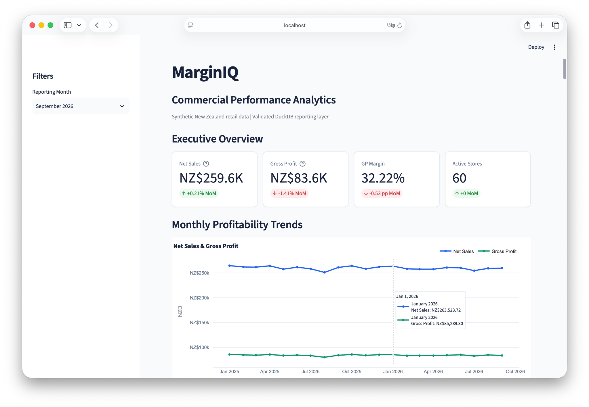
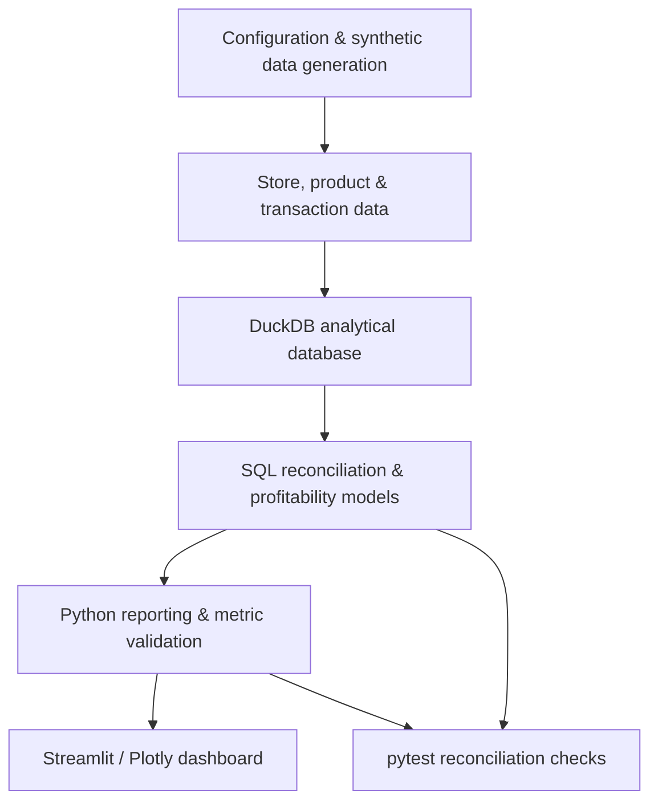
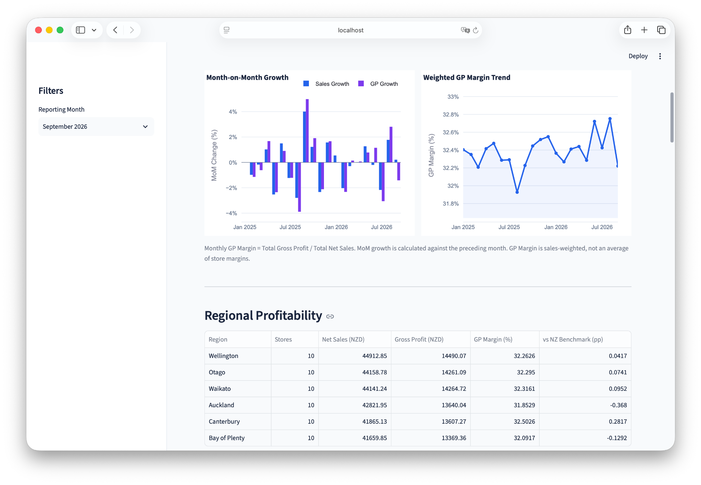
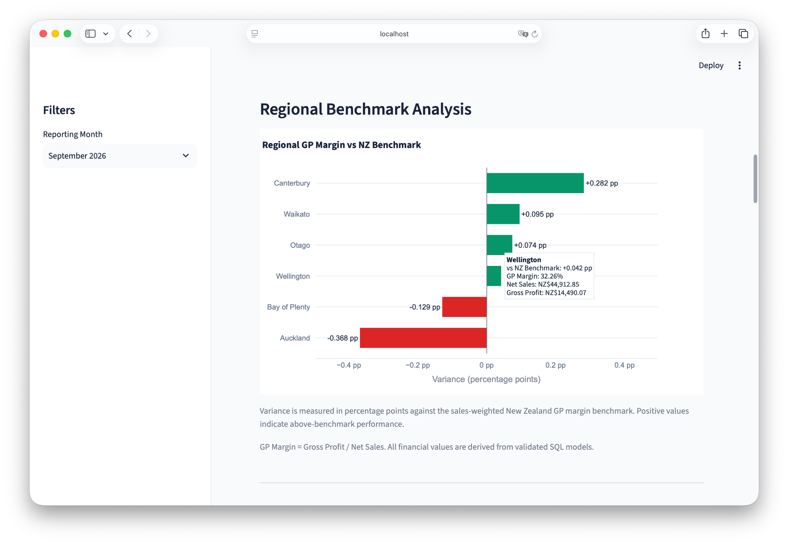
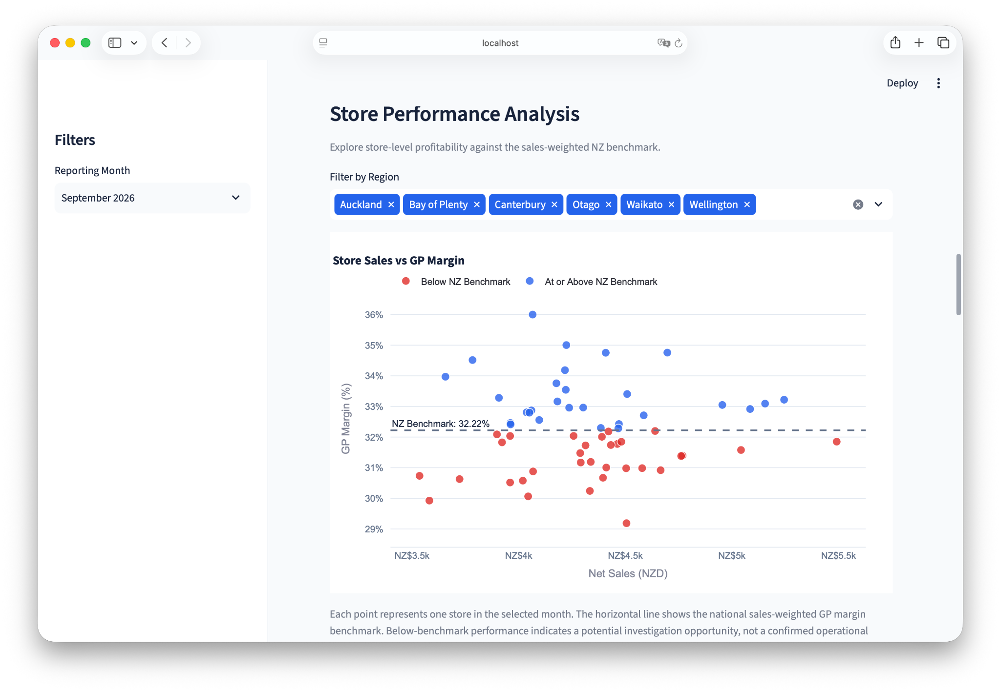
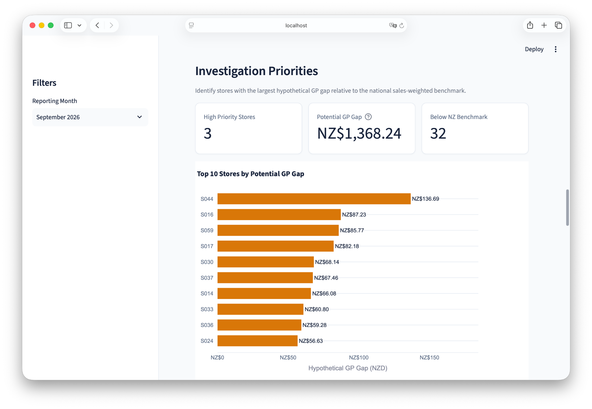
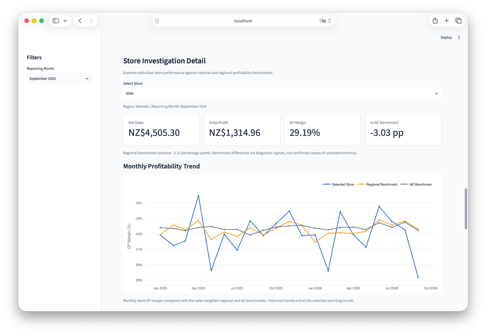
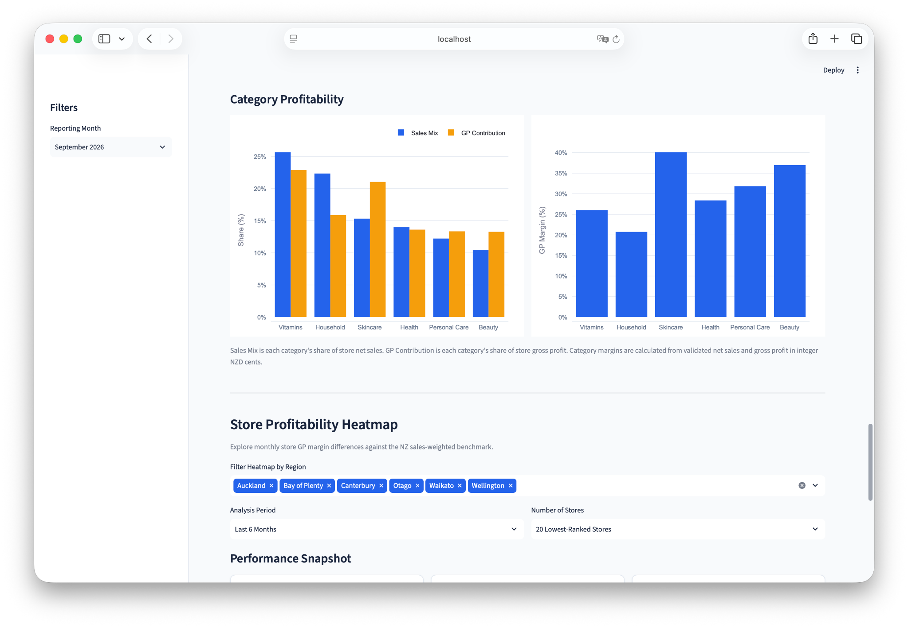
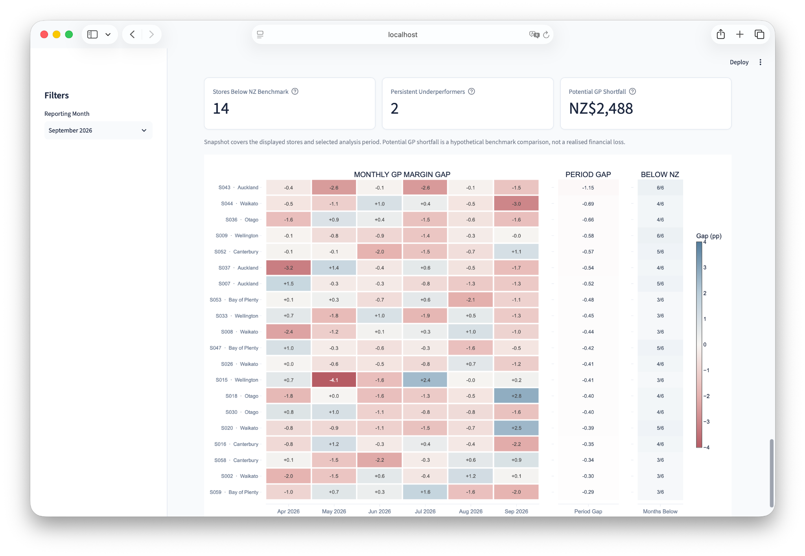

# MarginIQ — Commercial Performance Analytics

**A reproducible retail profitability analytics project using synthetic New Zealand retail data.**

MarginIQ combines transaction reconciliation, SQL-based profitability models and an interactive Streamlit dashboard to investigate where gross margin performance differs across stores, regions and product categories. The focus is on traceable calculations and investigation signals rather than unsupported causal claims.



## At a glance

| Coverage | Details |
| --- | --- |
| Stores | 60 fictional stores across 6 regions |
| Period | January 2025 – September 2026 (21 months) |
| Categories | 6 |
| Reporting grain | 1,260 store-month and 7,560 store-month-category records |
| Stack | Python, pandas, DuckDB, SQL, Streamlit, Plotly, pytest |

All stores, transactions and financial values are synthetic. MarginIQ is an analytical demonstration, not a full accounting P&L or a model of real commercial causes.

## Architecture



The reporting layer keeps the financial calculations separate from visual presentation. Tests check data-grain integrity, reconciliations and selected dashboard calculations.

## Dashboard walkthrough

### 1. Executive performance and trends

Monitor net sales, gross profit, sales-weighted GP margin and month-on-month changes. The reporting month filter determines the historical cutoff.



### 2. Regional benchmarking

Compare regional gross profit margins against the national sales-weighted benchmark; positive and negative differences are measured in percentage points.



### 3. Store-level performance

Examine the relationship between net sales and GP margin, with stores highlighted according to their position relative to the NZ benchmark.



### 4. Investigation priorities

Rank stores by hypothetical GP gap to guide further review. These differences are diagnostic benchmarks, **not realised losses or guaranteed savings**.



Select an individual store to compare its monthly margin with regional and national benchmarks.



### 5. Category profitability

Compare category sales mix with gross profit contribution, alongside category GP margins. Contribution and mix are calculated from the underlying sales and GP values.



### 6. Store profitability heatmap

Inspect monthly store GP margin gaps, the sales-weighted period gap and the number of months below the national benchmark. The snapshot summarizes the displayed stores and selected analysis period.



## Financial definitions

- **Gross profit:** net sales minus cost of goods sold.
- **GP margin:** gross profit divided by net sales.
- **Store contribution:** gross profit less labour, occupancy and other store costs.
- **Margin gap (pp):** store GP margin minus the NZ sales-weighted benchmark.
- **Period gap:** sales-weighted comparison across the selected months, not the simple average of monthly percentages.
- **Potential GP shortfall:** the sum of positive store-level shortfalls against monthly NZ benchmark amounts over the selected period; it is hypothetical, not a realised financial loss.

## Validation

The project includes automated checks for source-to-mart reconciliation, duplicate reporting keys, financial calculations and dashboard metrics. **175 tests passed** in the latest reported local test run (1 November 2026); this is a local validation result, not a claim of continuous integration status.

## Run locally

```bash
git clone https://github.com/SoyeonIm/retail-profitability-intelligence.git
cd retail-profitability-intelligence
python 3 -m venv .venv
 source .venv/bin/activate
python -m pip install -r requirements.txt
python src/generate_data.py
python src/build_database.py
python -m pytest -q
 streamlit run app.py
```

The setup commands are documented from the project workflow; a clean-environment install should be verified separately.

## Repository structure

```text
app.py                  Streamlit dashboard
config/                 Synthetic generation configuration
data/                   Generated data and local database
sql/                    Reconciliation and analytical models
src/                    Generation, reporting, metrics and charts
tests/                  Automated data and calculation tests
docs/                   Analysis notes, assumptions and screenshots
```

## Next steps

- Visualize GP margin decomposition using a waterfall chart.
- Expand category-mix and margin-driver investigation.
- Improve cross-filtering and store-level drill-down.

## Limitations

This project uses synthetic inputs and simplified retail assumptions. Apparent relationships are not evidence of real-world causation. Store contribution is not equivalent to a complete accounting P&L.
